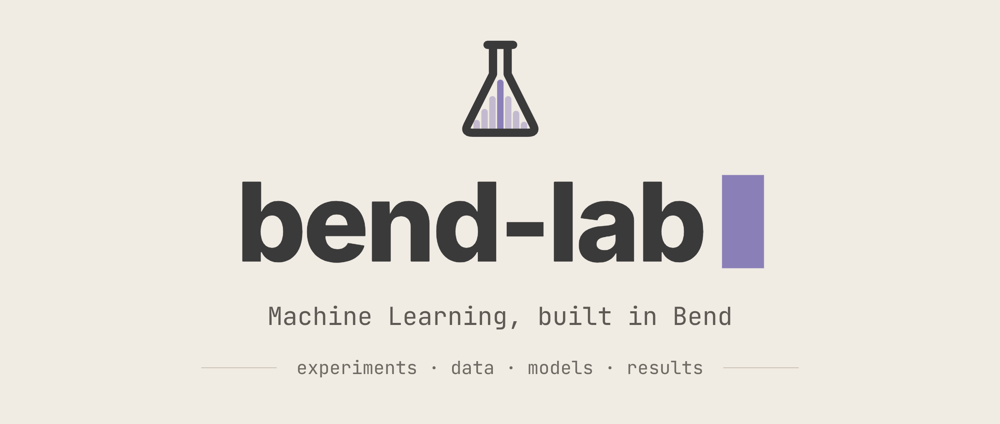

<p align="center">
  
</p>

# bend-lab

**Machine learning, built in Bend.** Models are written from scratch in
[Bend](https://github.com/bendlang/bend) and trained on
[BendTorch](https://github.com/nuxyel/BendTorch). Every number here was
measured by a program in this repository, and every surprise is dated in
[`issues-hit.md`](issues-hit.md).

This is an experiment corpus, not a library. The libraries are separate —
[bend-ml](https://github.com/nuxyel/bend-ml) owns the tensors and the laws,
BendTorch owns the training — and this is where they are **used, measured and
shown**. I write no trainer, tensor, autodiff or optimizer here; a model enters
through an example, not through a new engine.

<p align="center">
  <a href="https://github.com/adeerkhan/bend-lab/actions/workflows/ci.yml"></a>
</p>

## The rule: a number is checked three ways

1. **Against a NumPy twin** written at the same operation order
   (`reference/twin_*.py`), so a disagreement points at one operation, not at
   "the model".
2. **Against an outside implementation** where one exists — scikit-learn,
   PyTorch, and `lucidrains/denoising-diffusion-pytorch` vendored verbatim in
   `reference/lucidrains/` and run in its own environment.
3. **Against itself at a later version**, through frozen probes that pin
   intermediate values (`reference/probe_*.bend`).

When the three disagree, the disagreement is the finding. A number that was
not measured does not go in a README, a report card or a ledger entry.

## What it shows

The diffusion track is complete through a ViT denoiser: 2×2 patches, 16 tokens,
three pre-LN blocks, 100,736 parameters, 3000 steps on the first 1024 optdigits
images. Legibility is the mean best absolute correlation of a sample with any
training digit — random images score 0.326, the digits MLP 0.408, and the gate
is 0.75.

| arm (same data, sampler and starting noise) | DDIM 16 | ancestral 64 | DDIM MSE | ancestral MSE |
|---|---:|---:|---:|---:|
| **Bend-ViT** | **0.783** | **0.807** | 0.0618 | 0.0569 |
| PyTorch, same architecture | 0.790 | 0.779 | 0.0583 | 0.0633 |
| lucidrains UNet (reference) | 0.932 | 0.940 | 0.0202 | 0.0183 |

The Bend model is within 0.007 of the PyTorch twin on DDIM and ahead of it on
the ancestral sampler, on the same 4096 starting samples. Its cloud is
`+0.3007 / 0.3450` against the data's `+0.3076 / 0.3767`, and 4082 of 4096
pixels land in `[0, 1]`.

What closed the gap was the training loop, not the architecture: Bend drew one
timestep per batch and the reference draws one per image — worth **+0.36**
legibility (ISSUE-016). The evidence is in
[`results/diffusion-vit/`](results/diffusion-vit/) and the three-arm page in
[`results/compare/`](results/compare/index.html).

## Layout

```
examples/          what is run — one directory per task: main.bend, README.md, plot.svg
  classification/    knn, logistic, mlp, naive_bayes, naive_bayes_heart, crossval
  diffusion/         2d, digits, vit
  transformers/      attention, periodic
  unsupervised/      kmeans, pca
{metrics,hf,datasets,preprocess,split,select,cluster,pipeline,report,generative}/
                   the ten packages published to BendHub
reference/         what proves it — twins, probes, gates, comparisons, the task registry
results/           what it proved — run.json, REPORT.md, plots, the three-arm compare page
docs/              PLAN, AUDIT, the agent handoff
bench/             compute-only benchmarks
```

The rule for the tree: **the package directories are what I publish,
`examples/` is what I run, `reference/` is what proves it, `results/` is what it
proved.** Moving the packages under `packages/` and the verification layer
under `apparatus/` is the next structural step; the moves are mechanical but
touch `bend.toml` and every path, so they go in their own commit with
`make check` behind them.

## Quickstart

Bend 2.0.38, Lean 4.34.0, clang and the Python environment, one command:

```sh
make setup                                               # toolchain, lock, venvs
bendenv run -- bend examples/diffusion/vit/main.bend     # train and sample the ViT
make check                                               # the gate: proofs, kernels, twins, comparisons
```

`make check` is the gate. It checks the proofs and the kernel with Lean, runs
the programs that must be refused, and compares every measured number with a
NumPy or scikit-learn reference. On a cold machine it builds each program once;
that is the slow part.

## The corpus

| example | data | what is checked | result |
|---|---|---|---|
| `diffusion/vit` | optdigits, 1024 × 8×8 | legibility of 4096 samples, three arms | **0.783 / 0.807** (torch 0.790 / 0.779) |
| `diffusion/digits` | optdigits, 1024 × 8×8 | first loss against the twin; cloud statistics | 1.0039 (twin agrees to 2.9e-8) |
| `diffusion/2d` | two moons, 128 × 2 | loss curve, cloud mean and std | 152.95 → 0.065 |
| `transformers/periodic` | periodic 0…7, 32 × 8 | loss and next-token accuracy | 2.359 → 0.002, accuracy 1.00 |
| `transformers/attention` | synthetic 4 × 8 | every output against NumPy | checksum 1.76295, Δ 3.3e-9 |
| `classification/crossval` | iris, 150 × 4 | five stratified folds, no leakage | 0.9307 ± 0.006 (sklearn 0.9307) |
| `classification/knn` | breast cancer, 683 × 9 | accuracy on the same split | 0.978102 (sklearn 0.978102) |
| `classification/naive_bayes` | breast cancer, 683 × 9 | accuracy on the same split | 0.985401 (sklearn 0.985401) |
| `classification/naive_bayes_heart` | heart failure, 299 × 12 | accuracy on the same split | 0.950000 (sklearn 0.950000) |
| `classification/mlp` | iris, 150 × 4 | accuracy, 400 SGD steps | 0.973333 (sklearn 0.973333) |
| `classification/logistic` | iris, 150 × 4 | the loss over four steps | 1.0986 → 1.0672 |
| `unsupervised/kmeans` | wine, 6497 × 11 | inertia and cluster sizes | 50645.64, [2384, 990, 3123] |
| `unsupervised/pca` | wine, 6497 × 11 | explained variance ratio | 0.275443 (sklearn 0.275443) |

`make results` writes the full table, with the delta and the tolerance of every
task, to [`results/RESULTS.md`](results/RESULTS.md). The datasets, seeds, hub
hashes and git state of each run are in `results/latest/`.

## How a task is built

1. **An example** in `examples/<area>/<task>/main.bend` that trains and prints
   its numbers.
2. **A twin** in `reference/` — a NumPy mirror at the same operation order.
3. **A gate** in `reference/test_<task>.py`, wired into `make check`.
4. **A result** in `results/<task>/` — `run.json`, `REPORT.md`, plots.
5. **A ledger line** in `issues-hit.md`, with the date and the measurement.

Run one task, or the whole corpus, through the experiment layer:

```sh
reference/.venv/bin/python reference/experiment.py --list
reference/.venv/bin/python reference/experiment.py --task iris-crossval
```

Each run writes a report card and a manifest: the git commit, the Bend version,
every package at its hub hash, the machine, the seed and the tolerances.

## The ledger

[`issues-hit.md`](issues-hit.md) is the memory of the repository: twenty dated
entries, ten fixed, one upstream, none open, and the rest corrections,
withdrawals and diagnoses. It renders to
[`issues-hit.html`](issues-hit.html) with `make issues`.

The rule when a claim is wrong: the correction goes **above** the original
text, with the date — never a silent rewrite. ISSUE-014 (a claim that the GPU
lane was absent, withdrawn) and ISSUE-018 (the card runs and does not help)
keep their corrections this way on purpose.

## The GPU lane

`bend.toml` pins `bendtorch@1.1.1.0` and `bendtorch-gpu@1.1.1.0`. The ViT
builds with eight `LinearNBF` and one `F.Attention`, links `libnvrtc`, and
executes on an RTX 5060: `nvidia-smi` shows the process with 104 MiB on the
card, and the frozen values are **bit-identical** to the CPU lane.

It buys no speed yet — 5m44 either way. The time goes to plumbing: seven
`init_params()`, 1024 rows rebuilt per forward, and the `Mat.to_list`
conversions. That is ISSUE-018, and it turns CIFAR from a CUDA question into a
data-path question. The measurement that decides it — one step split into
`init_params`, one `rows_go` build, one `Mat.from_list`, one forward — is next.

## Status

- `make check`: **92/92**, green on `main`.
- Diffusion: complete through the ViT (gate at 0.75, measured 0.783).
- Flow matching: probe measured (loss 2.1253 → 0.8662), the 2D example is next.
- CIFAR-10: behind the plumbing measurement and a real step time.
- UNet in Bend: waiting on `Im2col` and `GroupNorm` upstream.
- Open upstream: `FullAttention` for BendTorch (BendTorch#17), `Im2col`
  (BendTorch#15), and the round-trip law on bend-ml (PR #27).

## Licence

MIT. See [`LICENSE`](LICENSE).
