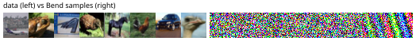

# A DDPM denoiser on CIFAR-10

The digits skeleton at CIFAR shapes: the first 256 rows of `arwics/cifar10` (pinned revision, its SHA-256 in the manifest), 32x32x3 images scaled to [0, 1]. An image's 3072 pixels plus 8 time-embedding values in (inwidth 3080), a 128-wide SiLU body, a 64-step linear schedule, 40 full-batch AdamW steps, then 8 fresh images two ways: the ancestral loop over all 64 rungs and DDIM over every 4th.

```console
$ bendenv run -- bend examples/cifar/main.bend
```

First loss **1.0014** against the NumPy twin's — the gate — and the data mean to 1.7e-9. Forty steps proves the pipeline, not a trained model: the final loss and the sample statistics are reported, not gated. The grid holds eight training images beside eight samples; the legibility report reads 0.071 against random images' 0.055, which is the underfit the 40-step budget buys. The curve, the grid and the manifest are in [`results/cifar-10/`](../../../results/cifar-10/).


