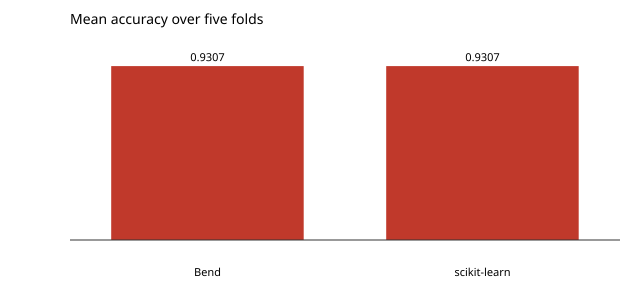

# Cross-validation, without leakage

The whole chain: iris from HuggingFace, the scaler fitted by `mlbend-pipeline` on the training rows of each fold, logistic regression with bend-ml's autodiff, the folds from `mlbend-select`, the score from `mlbend-metrics`.

```console
$ bendenv run -- bend examples/classification/crossval/main.bend
```

Mean accuracy **0.9307**, against scikit-learn's `Pipeline(StandardScaler, LogisticRegression)` at **0.9307** on the same folds: the program prints the fold of every row and the reference runs those folds, so the two numbers agree to 5.9e-8 instead of agreeing only about the procedure.


