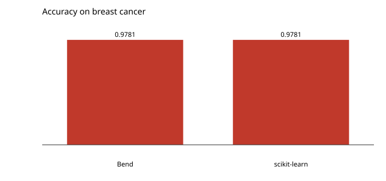

# k-nearest neighbours

Three nearest neighbours over the breast cancer dataset, standardised, with the first four fifths as the training rows. No gradients and no library: a distance and a vote.

```console
$ bendenv run -- bend examples/classification/main.bend
```

The accuracy is **0.978102**, against scikit-learn's **0.978102** on the same split (`reference/test_knn.py`).


