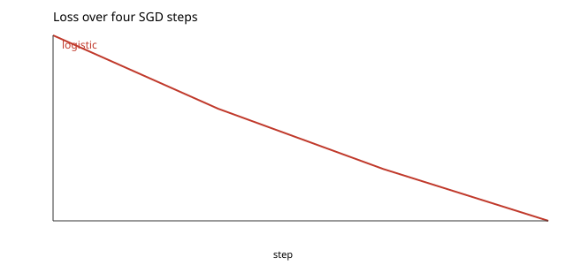

# Logistic regression

A logistic regression over iris with bend-ml's tensors and autodiff: `AG.linear`, `AG.ce_loss`, `AG.ce_grad`, `AG.linear_bwd`, `AG.sgd`. The learning rate is 0.01 because the features are not standardised.

```console
$ bendenv run -- bend examples/classification/main.bend
```

Loss **1.0986128 → 1.086162 → 1.0759476 → 1.0671557** over four steps.


