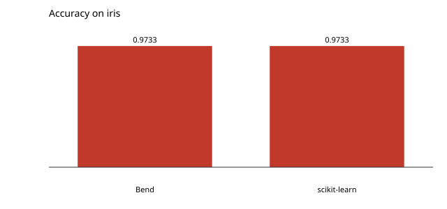

# A two-layer network

Eight rectified hidden units over iris with bend-ml's tensors and autodiff: `AG.linear`, `AG.mask.rows`, `AG.linear` again, cross-entropy, and the backward chain through both layers. 400 SGD steps.

```console
$ bendenv run -- bend examples/mlp/main.bend
```

Accuracy **0.973333**, the same as scikit-learn's `MLPClassifier(8)` (**0.973333**). The loss falls from 1.1172 to 0.1107.


