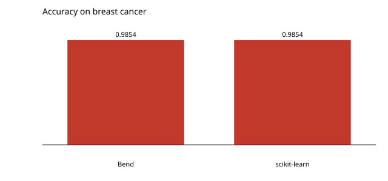

# Gaussian naive Bayes

A Gaussian per feature per class, trained on the first four fifths of the breast cancer dataset. The gradient-free baseline, with no standardising (a Gaussian is affine-invariant).

```console
$ bendenv run -- bend examples/naive_bayes/main.bend
```

The accuracy is **0.985401**, the same as scikit-learn's `GaussianNB` (**0.985401**).


