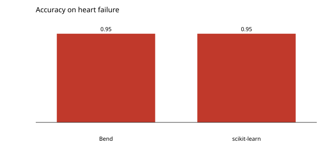

# Gaussian naive Bayes on heart failure

The same baseline as `naive_bayes`, on a second dataset: 299 rows of twelve features, the label `is_dead`, the first four fifths for training.

```console
$ bendenv run -- bend examples/naive_bayes_heart/main.bend
```

Accuracy **0.950000**, against scikit-learn's **0.950000** on the same split.


