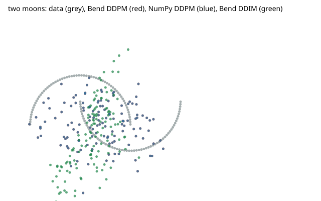

# A DDPM denoiser on two moons

A three-linear-layer SiLU denoiser on `bendtorch@1.0.1.0`, trained by AdamW for 4000 steps to predict the noise of a 64-step linear-β forward process over two moons, then sampled two ways: the ancestral loop over all 64 rungs, and DDIM over every 4th rung — 16 model calls instead of 64, and at η = 0 a step reads no noise at all. Every random number is a pure function of a counter (murmur3's fmix32 over the step salt and the index, Box-Muller over 24-bit uniforms), so the NumPy twin draws the same ones.

```console
$ bendenv run -- bend examples/diffusion/main.bend
```

First loss **152.9537** against the twin's — the gate — and final loss **0.0650**, reported. Both clouds' statistics are report-mode: the optimizers round differently and a 64-step loop amplifies a ulp. The curve, the cloud and the manifest are in [`results/diffusion/`](../../results/diffusion/).


