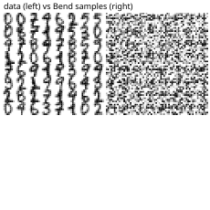

# A DDPM denoiser on digits

The same task over real data: the first 1024 rows of `mstz/optdigits` (pinned revision, its SHA-256 in the manifest), 8x8 digits scaled to [0, 1]. A digit's 64 pixels plus 8 time-embedding values in, a 64-wide SiLU body, a 64-step linear schedule, 3000 full-batch AdamW steps, then 64 fresh digits two ways: the ancestral loop over all 64 rungs and DDIM over every 4th. Both samplers reconstruct the model's implied start, clamp it to [0, 1], and form the posterior mean from that start — without the clamp the chain walks away from the data even when the denoiser predicts noise well (`issues-hit.md`, ISSUE-005).

```console
$ bendenv run -- bend examples/diffusion_digits/main.bend
```

First loss **1.0039** against the NumPy twin's — the gate — and the data mean to 4.6e-9. The final loss and both clouds' statistics are reported, not gated: the optimizers round differently over 3000 steps. `reference/test_diffusion_digits.py` also compares both samplers with the twin element by element, over frozen weights. The curve, the grid and the manifest are in [`results/diffusion-digits/`](../../results/diffusion-digits/).


