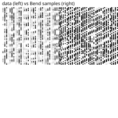

# A DDPM denoiser on digits

The same denoiser over real data: the first 1024 rows of `mstz/optdigits` (pinned revision, its SHA-256 in the manifest), 8x8 digits scaled to [0, 1]. 64 pixels in, a 64-wide SiLU body, 64-step schedule, 3000 full-batch AdamW steps, then 64 fresh digits by the ancestral loop. The image shows real digits on the left and the samples on the right.

```console
$ bendenv run -- bend examples/diffusion_digits/main.bend
```

First loss **8062.69** against the NumPy twin's — the gate — and the data mean to 4.6e-9. The final loss and the grid are reported, not gated: the underfit denoiser makes the sampler expand geometrically, which is the known follow-up (a residual head). The curve, the grid and the manifest are in [`results/diffusion-digits/`](../../results/diffusion-digits/).


