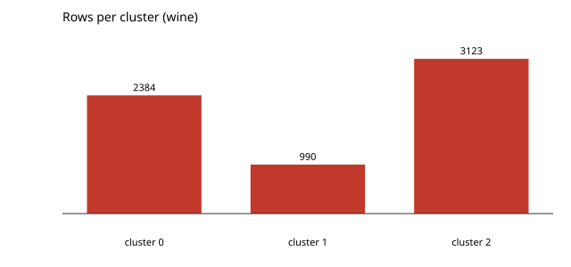

# k-means over wine

Three clusters, ten rounds, through `mlbend-cluster` after standardising the columns. The algorithm lives in the package; the example holds the data and the standardising.

```console
$ bendenv run -- bend examples/kmeans/main.bend
```

Inertia **50645.64**; cluster sizes **2384 990 3123**. The same numbers as the NumPy implementation (`reference/test_kmeans.py`).


