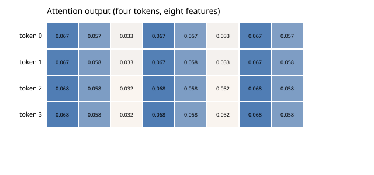

# Single-head self-attention

The core of a transformer in plain Bend: Q, K and V projections, the scaled dot-product scores, a row softmax and the weighted sum of V. Four tokens of eight features, fixed weights; every output agrees with the NumPy reference to 1.5e-8.

```console
$ bendenv run -- bend examples/transformers/main.bend
```

The heatmap is the 4 × 8 output; `reference/test_attention.py` checks every number and the checksum.


