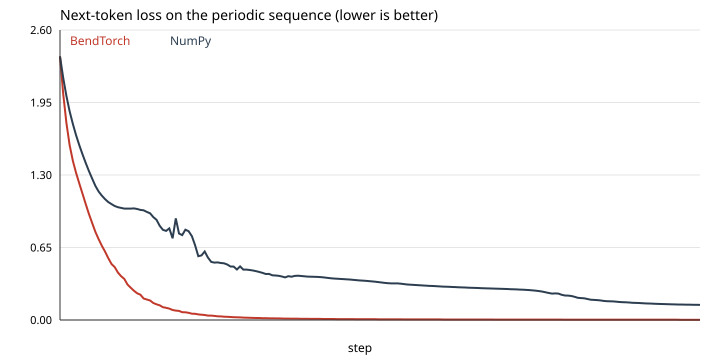

# A trained transformer

A one-block causal transformer on `bendtorch@1.0.1.0`: embedding, RMSNorm, single-head causal attention, output projection, RMSNorm, linear head. AdamW, 200 steps, next-token prediction on the periodic sequence 0..7.

```console
$ bendenv run -- bend examples/transformers/periodic/main.bend
```

Loss **2.3591 → 0.0021**, next-token accuracy **1.0000**. The NumPy twin starts at the same loss and ends at 0.1351 with accuracy 0.9375; the full curve and the manifest are in [`results/transformer/`](../../results/transformer/).


