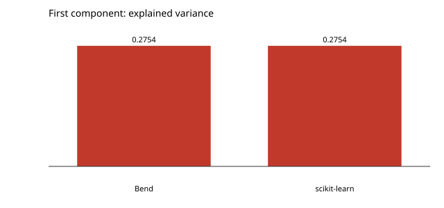

# The first principal component

The covariance matrix of the standardised wine features and a hundred power iterations for its first eigenvector. A transformer, not a trainer.

```console
$ bendenv run -- bend examples/unsupervised/main.bend
```

Explained variance ratio **0.275443**, against scikit-learn's **0.275443**.


