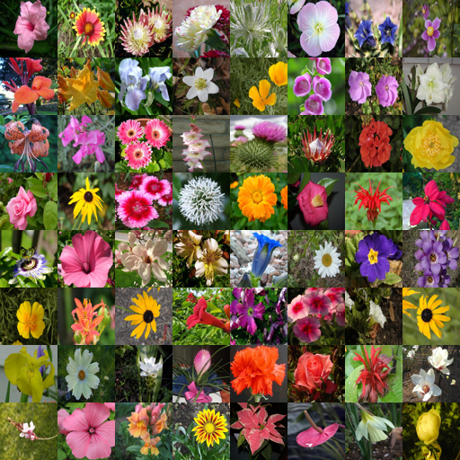
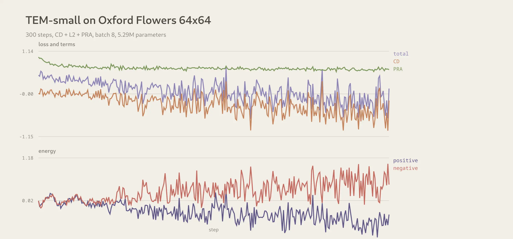

# TEM: Transformer Energy-Based Model

**Paper:** *Scaling Transformer Energy-based Models For High Quality Image
Synthesis*, Jungsoo Lee, Alexi Gladstone, Yilun Du, arXiv 2610.31889, 2026.

**Official code:** [int-lee/TEM](https://github.com/int-lee/TEM). The code has
no license, so nothing is vendored here; this is an independent implementation
from the paper.

## What the paper claims

A class-conditional energy model over SD-VAE latents, sampled with Langevin
dynamics. The backbone is a ViT with 2D RoPE, QK-RMSNorm, SwiGLU and shift-free
adaLN; energy heads at one third, two thirds and the end of the depth are
summed. Positive Representation Alignment (PRA) aligns intermediate tokens with
DINOv2 features; training is contrastive divergence with an L2 energy
regularizer, a KL term through one differentiable Langevin step, and a
repulsion term against the replay buffer.

| paper arm | params | resolution | steps | FID-50K, no CFG |
|---|---:|---:|---:|---:|
| TEM-L/2 | 415M | 256x256 | 60 | 4.74 |
| TEM-XL/2 | 609M | 256x256 | 60 | 3.82 |
| TEM-XL/2 | 609M | 512x512 | 60 | 8.24 |

Inference-time scaling at 256x256: 40 steps 7.63 FID, 60 steps 3.82, 80 steps
4.72. The paper also shows compositional generation, zero-shot inpainting and
out-of-distribution detection.

## Protocol here

The paper's numbers cannot be produced on this machine: 8 GPUs, ImageNet, an
SD-VAE and DINOv2-L are out of scope. This folder runs a **64x64 pixel-space**
version of the same energy:

| | paper | here |
|---|---|---|
| data | ImageNet 1.28M | Oxford Flowers 102, 7169 train / 1020 test |
| resolution | 256x256 SD-VAE latent | 64x64 pixels |
| model | ViT-L/XL, 415-609M | ViT, depth 6, width 192, 6 heads, 4.63M |
| energy heads | 3, at 1/3, 2/3, end | 3, at 1/3, 2/3, end |
| conditioning | class, adaLN | class, adaLN |
| PRA | DINOv2-L, block 1/3 | DINOv2-S at 112x112, block 1, cosine |
| KL term | one differentiable step | not in this arm |
| repulsion | yes | not in this arm |
| Langevin | 40 steps, step 500 (latent) | 20 training / 40 sampling, step 0.01 (pixel) |
| optimizer | AdamW, 2e-4 | AdamW, 2e-4 |
| batch | 8 x 8 accumulation | 8 |

The loss is the paper's: `E(pos)^2 + E(neg)^2 + E(pos) - E(neg)`, with
negatives from the replay buffer after `sample_steps - 1` noisy Langevin steps
and one final step without noise, plus `0.5 * (1 - cosine)` against DINOv2-S
patch features.

One stabiliser is local to this protocol: the last layer of each energy head has no bias, so a
constant energy is not a reachable minimum of the CD loss. At 4.6M parameters
the bias let the model settle on exactly that, and the samples were pure noise.
The paper can leave the bias in at its scale.

## Findings so far

**The constant-energy collapse is real at this scale.** The first Python arm
(800 steps, no PRA, biased head) reached loss `-1.4996`, positive energy
`-1.51`, negative energy `+1.49`, and produced pure noise. The energy gradient
on the noise was 0.073 in L2, on real images 0.013, both far too small for the
sampler: 40 Langevin steps at step 0.01, 0.05, 0.2, 0.5 or 1.0 left the cloud
at noise (nearest test image 82.1 to 82.2, against 84.1 for the initial noise).
This is the exact minimum of `alpha(E^2) + E(pos) - E(neg)`.

### Data pins

Source: `nelorth/oxford-flowers` on HuggingFace, the official Oxford Flowers
102 set.

| split | parquet sha256 | 64x64 npz sha256 | images |
|---|---|---|---:|
| train | `f53b6c9f81c492a0b897006d794bcb485f10022e9cc953a11632d2f91a61482e` | `940d76c746c3b5e625aa258cb194178127c50d65d7ffe03cf945e630724a423f` | 7169 |
| test | `f7582775856bfbb59f4bffed920b0977ebd1722deea93d6200e840732b92e4a0` | `4ad443eba4d337d2a9fc63eec60856271aa59090849f91ec3b10baa84528f956` | 1020 |

The cache is built once by `papers/TEM/data.py --build` and lives under
`~/.cache/bend-lab/flowers`; it is not committed.

## Results

Four Python runs on the same 64x64 flowers data. The contrastive arms collapse;
the denoising arms move toward the data but do not reach a usable sampler at
this compute budget.

| run | steps | loss, last 50 | nearest test image | samples |
|---|---:|---:|---:|---|
| CD + L2, noise buffer | 800 | -1.4987 | 82.7 | noise |
| CD + L2 + PRA, data buffer | 300 | -0.1747 | 82.7 | noise |
| denoising energy regression, sigma 0.2 | 1500 | 0.0527 | 77.6 | noise |
| denoising score network, sigma 0.2 | 2000 | 8.03 | 61.7 | noise, textured |

For scale: the initial noise is 84.1 from the test set, so the score network
does move (84.1 to 61.7), but it is not a flower sampler.

**Why the contrastive arms collapse.** The plain run reached the exact
constant-energy minimum of `alpha(E^2) + E(pos) - E(neg)`: positive energy
-1.51, negative +1.49, and a field so weak that 40 Langevin steps at step 0.01
to 1.0 left the cloud at its initial noise.

The fixes tried, in order:

- PRA with DINOv2-S. The alignment loss learned (1.00 to 0.66), so the trunk
  carried content, but the energy head still went to the constant.
- A bias-free last energy layer. The head recovered a near-constant through
  the hidden bias instead.
- A batch-variance term at 0.1 and at 1.0. It was gamed by a few samples.
- A data-initialized replay buffer. This kept the energies moderate and learns
  a local denoiser around real images, but the sampler starts from noise where
  that field is flat.

**Why the denoising arms are not enough either.** The energy regression target
`mean(eps^2)/(2 sigma^2)` is almost constant across a batch (12.5 +/- 0.16 at
64x64), so the model can fit it with a constant and the gradient stays flat.
The score network is first-order and does learn: its loss falls from 25.1 to
8.0 and the nearest-test distance from 84.1 to 61.7. But 2000 steps over 32k
images is three orders of magnitude below the paper's 12.8M images, and the
samples stay noise.

**Conclusion.** TEM's result depends on scale. This folder records the
reduced protocol, the collapse, the denoising variants and the compute wall.
It does not claim the paper's numbers.

## The Bend arm

Not started, and the reason is not portability. A faithful port needs four
things BendTorch does not have on `devel`:

- full (non-causal) attention. `Attention` is causal only (BendTorch#17);
- 2D RoPE;
- shift-free adaLN;
- a conv patch embedding, which can be a gather plus a linear, so this one is
  not a blocker.

A port would be a custom transformer, and there is no working Python field to
port yet. The next step is to make the Python arm train (larger scale, or an
explicitly different denoising objective), then port that. Porting the
collapsed field would only demonstrate the port.
