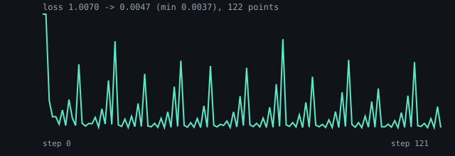
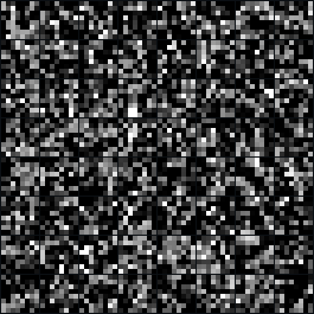

# diffusion-vit — report card

The Bend ViT denoiser over the first 1024 optdigits digits: `examples/diffusion_vit/main.bend`,
sampled by the 16-step DDIM walk with the clamped start.

| | value |
|---|---|
| first loss | 1.006968 |
| final loss | 0.003285 (minimum 0.001668) |
| legibility (mean, min, max) | **0.341**, 0.195, 0.573 |
| steps | 1200 (the comparison's arms train 3000) |
| cloud mean / std | +0.2812 / 0.3097 (data 0.3076 / 0.3767) |
| pixels in [0,1] | 4092/4096 |
| nearest-digit MSE | 0.2100 (uniform noise 0.266) |

Legibility is the best absolute correlation of each sample with any training
digit, averaged. Random images score 0.326, the digits MLP 0.408, torch's
*causal* ViT 0.774, the vendored lucidrains UNet 0.926. The M2 gate is 0.75.

Architecture: 2x2 patches, 16 tokens of 20 features (4 pixels, 8 time, 8
position), width 64, one head, three pre-LN blocks, one 4-value head per
patch, 100,736 parameters, every layer BendTorch's. BendTorch's `Attention`
is causal (ISSUE-011), so the 16 tokens are attended as a sequence; the
torch arm of the comparison runs the same mask.
