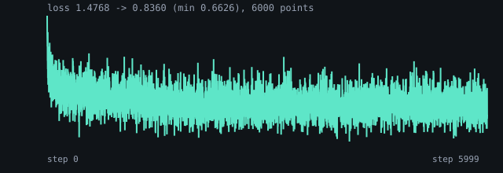
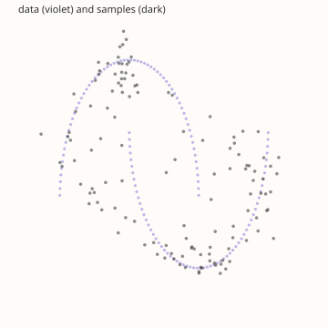

# flow-2d: rectified flow on two moons

`examples/diffusion/flow_matching/main.bend`, three linear layers with SiLU
(128 wide), trained full-batch for 6000 steps with AdamW at 3e-3. The data
is the DDPM example's two moons, normalised to [-1, 1] per axis. The sample is
Euler over 32 steps of `linspace(0, 1)`.

| | value |
|---|---|
| first loss | 1.4768 |
| final loss | 0.8360 |
| last 100 mean | **0.8859** |
| data mean / std | -0.000 / +0.000  ·  0.577 / 0.659 |
| sample mean / std | +0.049 / -0.048  ·  0.610 / 0.675 |
| inside the data's box | 112/128 |

The NumPy probe (`reference/flow_probe.py`, 4096 points, 6000 steps) measured
loss 2.1253 -> 0.8662, samples mean [-0.111, 0.150] / std [0.546, 0.745]
against its data's [-0.002, -0.000] / [0.583, 0.741], and 465/512 inside the
box. This example runs the same method on the repository's own 128-point data,
so the means and the box count are compared with that data.

